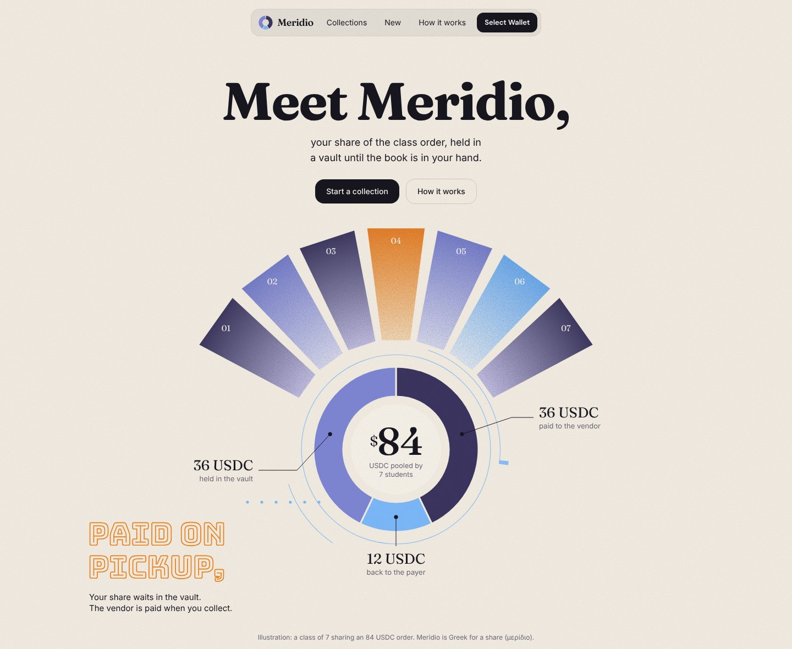
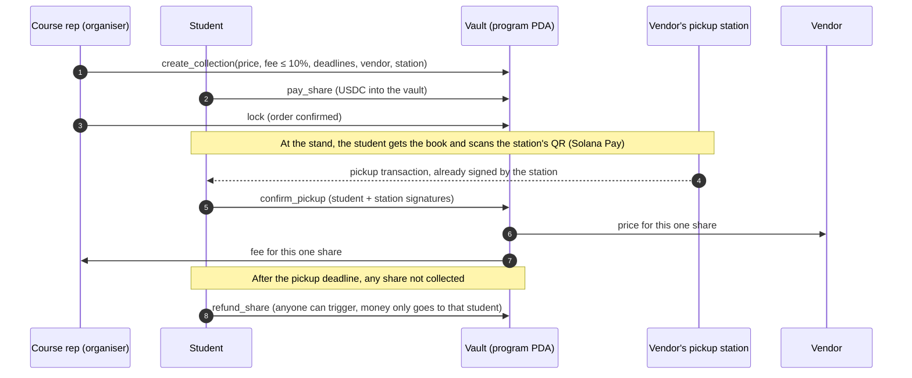

# Meridio

**Your share of the class order stays yours until the book is in your hand.**

Meridio (Greek *μερίδιο*, "a share") is a Solana program and app for class purchases: textbooks, handouts, lab coats, dues. Each student's money sits in a vault that no person can empty. The vendor is paid **one share at a time, only when that student collects**. Whatever is never collected goes back to the student who paid it.



> Built for the **Dev3pack Global Hackathon** (Solana university hackathon, 27–29 Nov 2026). Runs on **Solana devnet** with test USDC. Unaudited.

---

## The problem

In Nigerian universities, class money usually goes to one person's account: the course rep's. Then trust does the rest.

- **UNIPORT, Cyber Security:** a course rep collected ₦27,000 each from more than 400 students for a compulsory textbook, over ₦10.8M in total. Only **80 copies** were reportedly produced, leaving more than 320 students without books. ([MySchoolNews](https://myschoolnews.ng/uniport-students-demand-books-after-108-million-textbook-payment-goes-missing))
- **Ignatius Ajuru University (IAUE), Accountancy:** a course rep and his assistant were accused of disappearing with **₦6.4M** paid by more than 150 students for four textbooks. Unconfirmed reports said the university declared them wanted. ([Legit.ng](https://www.legit.ng/people/1550394-ignatius-ajuru-university-rep-assistant-run-allegedly-embezzling-n64m-textbook-money/))

Universities respond by banning course reps from selling books. That removes the convenience and still leaves no way to pool money safely.

**With Meridio, the UNIPORT case settles itself:** the vendor is paid for the 80 books students actually collected, and the other 320 shares become refundable to the students who paid them. Nobody has to chase anybody.

## How it works



| Step | Instruction | Who signs | Money moves |
| --- | --- | --- | --- |
| Rep sets up the purchase | `create_collection` | organiser | none |
| Student pays | `pay_share` | student | student → vault |
| Student changes their mind (before pay-by) | `cancel_share` | student | vault → that student |
| Order confirmed | `lock` | organiser, or anyone after pay-by | none |
| Rep calls it off (before lock) | `cancel_collection` | organiser | none (all shares become refundable) |
| Pickup at the stand | `confirm_pickup` | student **and** station | vault → vendor (price) + organiser (fee) |
| Deadline passed, not collected | `refund_share` | anyone | vault → that student only |
| Clean up | `close_collection` | organiser | rent back |

### Who can do what (trust model)

| Party | Can | Cannot |
| --- | --- | --- |
| Course rep (organiser) | Set up, lock or cancel the order; earn a capped fee per pickup | Touch the vault; pay the vendor without a pickup; take more than fee × pickups |
| Student | Pay, cancel before pay-by, confirm their own pickup, get refunded | Confirm someone else's share; be refunded twice |
| Vendor | Get paid for each share that is collected | Get paid for a share without that student's signature |
| Pickup station (server key) | Co-sign pickups and pay their network fees, so students need no SOL | Move money on its own: every pickup also needs the student's signature |
| Anyone | Trigger refunds after the deadline | Send a refund anywhere but the student who paid |

If the server and its station key were stolen, the attacker still could not move a single share: every payout needs the student's own signature, and refunds can only go back to the payer.

## Invariants

Enforced by the program and checked by the tests after every step:

1. The vault always holds exactly the sum of shares still marked **Paid**.
2. A share settles once: picked up or refunded, never both, never twice.
3. Money leaves the vault only to the vendor, the organiser's fee account, or the share's own buyer.
4. The organiser can never receive more than fee × pickups (fee capped at 10% of price).
5. A pickup needs both the buyer's and the station's signature, before the pickup deadline.
6. Only the collection's own mint is accepted. Amounts are whole base units; nothing is divided, so nothing rounds.

## Attacks tested

**Program (Rust, LiteSVM): 16 tests**

| Test | What it proves |
| --- | --- |
| `t1_full_path_pay_lock_pickup_refund_close` | The whole lifecycle settles to the right balances |
| `t2_organizer_cannot_take_the_money` | The rep cannot redirect vault funds to themselves |
| `t3_pickup_needs_the_real_station_signature` | A fake station key is rejected |
| `t4_buyer_cannot_confirm_someone_elses_share` | You can only release your own share |
| `t5_no_double_pickup` | A share pays the vendor once |
| `t6_no_pickup_after_deadline` | Late pickups are refused |
| `t7_no_early_refund_while_locked` | No refunds while pickups are still open |
| `t8_stranger_crank_pays_the_buyer_only` | A third-party refund still pays the original buyer |
| `t9_wrong_mint_rejected` | Look-alike tokens are refused |
| `t10_not_enough_buyers_means_refunds` | Below the minimum, everyone is refundable |
| `t11_cancel_share_only_while_open` | Students can back out only before pay-by |
| `t12_creation_rules` | Fee cap, deadlines, buyer limits, title length |
| `t13_invariant_fuzz` | Random sequences of actions keep every invariant and conserve total tokens |
| `only_organizer_locks_early_and_cancels` | Early lock and cancel are the organiser's alone |
| `close_refused_while_shares_outstanding` | A collection cannot close while money is owed |
| `rep_can_also_be_the_vendor` | A rep who also sells the item gets price and fee in one account (found in devnet testing, fixed) |

**App server and client (Node test runner): 19 tests**

| Area | What it proves |
| --- | --- |
| Station sign-in | Only the vendor's wallet can open a pickup station, only for that collection, only within 5 minutes of signing; forged or stretched session tokens fail |
| Pickup codes | Codes are bound to one collection, expire after 90 seconds, and cannot be extended or altered |
| Verify before signing | The student's page rebuilds the expected pickup from chain data, compiles it, and requires the exact same bytes as the message the wallet will sign. It refuses an extra transfer, a swapped account, changed data, a changed signer or writable account, or the student as fee payer, including after the transaction's real trip over the wire (a false alarm found in devnet testing, now covered) |
| Configuration | The server refuses to run a station without both secrets set |
| Readable errors | Every transaction is simulated before the wallet sees it, so a failing action shows the program's own reason (e.g. "The pay-by time has passed") instead of a wallet's "Unexpected error" |

## Verify it yourself

| Check | Command | Expected |
| --- | --- | --- |
| Program tests | `cd programs/meridio && cargo test` | `test result: ok. 16 passed; 0 failed` |
| App tests | `cd app && npm test` | `# pass 19` and `# fail 0` |
| Lint | `cd app && npm run lint` | no problems reported |
| Production build | `cd app && npm run build` | route list, no errors |
| Program on devnet | `solana program show 2CY5o9hxJLfmSj8cZfxRKsa8GXJxTFxry5bWfqTfNziv --url devnet` | program account owned by the BPF loader |

**Devnet deployment**

| | |
| --- | --- |
| Program ID | [`2CY5o9hxJLfmSj8cZfxRKsa8GXJxTFxry5bWfqTfNziv`](https://explorer.solana.com/address/2CY5o9hxJLfmSj8cZfxRKsa8GXJxTFxry5bWfqTfNziv?cluster=devnet) |
| Deploy transaction | [`5N2UiZci…1qpQHN`](https://explorer.solana.com/tx/5N2UiZcigQquMy9UwPaX6G2bUe78wNkcqH9RG7g9v3fU5MEfqsaPPw2Dd9XofVtvdUVNEPgu5CaT8kWJXU1qpQHN?cluster=devnet) |
| First collection created from the app | [`4VMAwK9b…tJnB5rZ`](https://explorer.solana.com/tx/4VMAwK9bzF2mtr9DrB7V2AcUBnupS73ujkDeWMREXvoUzyS8SVWBo9H2sz98ue3gBjhpSrwQK8TJmJoaGtJnB5rZ?cluster=devnet) |
| First pickup (student + station signed; vendor and rep paid from the vault) | [`5DLuKqLX…Z5q5DWk`](https://explorer.solana.com/tx/5DLuKqLXvnEapB8xx1a9RjqQY37WN6dcqY8hr1aXEQffRKgWDXRXNRUnxUARDUbvKu6gsHbJya2Ws83rYZ5q5DWk?cluster=devnet) |
| Test USDC mint | `4zMMC9srt5Ri5X14GAgXhaHii3GnPAEERYPJgZJDncDU` (Circle devnet USDC, [faucet](https://faucet.circle.com)) |

## The app

Next.js 16, React 19, Tailwind 4, `@anchor-lang/core`, Solana wallet adapter, and the Solana Mobile Wallet Adapter for Android.

| Page | For | What it does |
| --- | --- | --- |
| `/` | everyone | What Meridio is, and every collection on chain |
| `/new` | course rep | Create a collection: item, price, fee, deadlines, vendor wallet |
| `/c/[id]` | everyone | Live ring of collected / held / refunded shares, pay or cancel your share, organiser controls, refund button, public receipt list read straight from chain |
| `/c/[id]/station` | vendor | Sign in with the vendor wallet, then show a pickup QR that changes every minute |
| `/c/[id]/collect` | student | Same-device pickup: check the transaction, then sign |

**Pickup, step by step.** The vendor's screen shows a [Solana Pay transaction request](https://docs.solanapay.com/spec#transaction-request) QR. The student's wallet sends its address to `/api/pickup`, which checks the code, the deadline and the share, then returns a `confirm_pickup` transaction already signed by the station (the station pays the fee). The student signs only after the item is in their hand. In the in-app collect flow, the page first rebuilds the expected transaction from chain data and refuses anything that differs.

All data is read from Solana. There is no database to fall out of sync, and every receipt is a transaction anyone can look up.

## Run it

**Program.** Requires Rust (pinned by `rust-toolchain.toml`), Solana CLI 3.1.x and Anchor 1.1.2.

```bash
anchor build
cd programs/meridio && cargo test
```

Deploy your own copy to devnet:

```bash
solana config set --url devnet
anchor keys sync        # writes your program ID into the code
anchor build
anchor deploy --provider.cluster devnet
```

**App.** Requires Node 22+.

```bash
cd app
npm install
cp .env.local.example .env.local
solana-keygen new -o station.json --no-bip39-passphrase   # the pickup station key
# paste the contents of station.json into STATION_SECRET_KEY, and set SESSION_SECRET:
openssl rand -hex 32
solana airdrop 1 $(solana-keygen pubkey station.json) --url devnet   # station pays pickup fees
npm run dev
```

Open http://localhost:3000, connect a devnet wallet holding test USDC, and start a collection. If you deployed your own program, copy `target/idl/meridio.json` and `target/types/meridio.ts` into `app/src/lib/idl/`.

## Repository layout

```
programs/meridio/      Anchor program (Rust)
  src/instructions/    one file per instruction
  tests/meridio.rs     LiteSVM tests, including the invariant fuzz
app/                   Next.js app
  src/app/api/         station sign-in, pickup codes, Solana Pay pickup endpoint
  src/lib/meridio.ts   PDAs, decoders, instruction builders
  src/lib/pickupCheck.ts  verify-before-sign for pickup transactions
  src/lib/server/      station key, sessions and codes (server only)
  tests/               Node tests for the server and the transaction check
docs/                  screenshots
```

## Status

| Part | Status |
| --- | --- |
| Solana program (8 instructions) | Built; 16 tests pass; deployed to devnet |
| Web app: create, pay, lock, pickup QR, collect, refunds, receipts | Built; 19 tests pass; production build passes. On devnet: create, pay, lock and pickup done with a real wallet; refund not yet |
| Android: Mobile Wallet Adapter | Registered in code; not yet tested on a device |
| Hosting | Not yet deployed |
| Firecrawl price check, ElevenLabs voice updates | Not yet built |

## Honest limits

- Devnet only, and unaudited.
- A pickup proves both the student and the station signed at the stand. It cannot prove the item was the right edition.
- For the demo, the station key lives on the server. In production it would live on the vendor's own phone.
- The Solana Pay QR path relies on the student's wallet to show what it is signing; the in-app collect page adds its own check on top.
- Students need a wallet and USDC. There is no naira on-ramp yet.
- Wallet addresses are public on chain. Names stay off chain.
- Station sign-in has no per-request nonce: a captured sign-in signature could be replayed within its 5-minute window, and only for that one collection's pickup codes.

## Team

Built by Eleazar ([@0xNexuz](https://github.com/0xNexuz)), FUTUREUNI, Benin City.

## License

[MIT](LICENSE)
